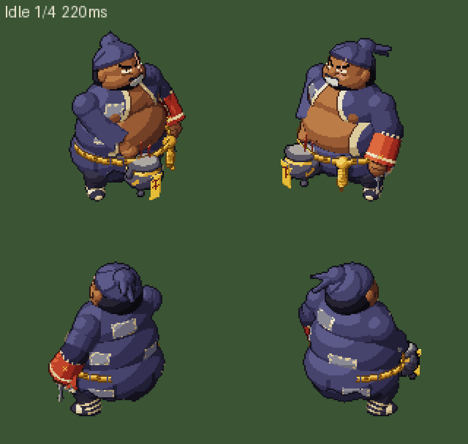

# Agent Toolkit Portfolio

我在 Unity 游戏开发中使用编程 Agent（Claude Code、Codex）时搭建的工具、规则和产出，主要服务于 2D 肉鸽构筑游戏《苍灵志》（[Lilith-Portfolio](https://github.com/DaliBerr/Lilith-Portfolio)）。

目标是让 Agent 能安全地参与日常开发：读写编辑器不搞坏资源，测试不越界，多个 Agent 不互相覆盖，游戏能被 Agent 直接驱动验证，美术特效能由 Agent 以可编辑的方式产出。

> 作者口径：规则、协议与流程由我设计，代码大量借助 Agent 编写，并由我审查和验收。

## 目录

| 目录 | 内容 | 对应问题 |
| --- | --- | --- |
| [`unity-editor-ops/`](unity-editor-ops/) | Unity MCP 命令行客户端（Python 标准库，18 个离线测试）及其 Skill | Agent 操作编辑器时的路由、门禁和多 Agent 互斥 |
| [`agent-rules/`](agent-rules/) | 仓库 AGENTS 规则、Unity 通用安全规则、多 Agent 监管流程、记忆规则 | 序列化资源保护、测试边界、单写者、长期记忆分层 |
| [`skills/`](skills/) | 仓库操作 Skill、监管 Skill | 让 Agent 按需加载项目规范和排障索引 |
| [`runtime-automation/`](runtime-automation/) | 运行时自动化协议包（Unity UPM，约 1900 行 C#）、核心测试与协议文档 | 让 Agent 不借助 Computer Use、用结构化状态驱动游戏 |
| [`agent-art/`](agent-art/) | Agent 用 pixelfx 编写的特效与敌人动画源码、预览 | 让 Agent 产出可编辑、可复现的像素美术 |

## 1. 编辑器操作：unity-editor-ops

编辑器侧使用开源的 [MCP for Unity](https://github.com/CoplayDev/unity-mcp) 服务。`scripts/unity_ops.py` 是我的客户端：

- 只用 Python 标准库实现 Streamable HTTP MCP 客户端，按项目别名路由到不同端口的编辑器实例。
- **门禁**：拒绝进入 PlayMode；Lilith 测试只接受非空的精确测试类/方法名，拒绝空列表、通配、命名空间和已知的房间生成测试；直接调用和 batch 嵌套调用走同一道检查。
- **单写者**：同一个编辑器同一时间只允许一个写入者；需要专用执行者时，用文件队列（pending → claimed → completed/failed）交接一个原子请求，同一端点已有 claimed 时拒绝第二次领取，超时不自动释放或重放。
- 写请求必须声明 lease、Prefab 快照路径、Prefab Stage 状态和 `play_mode=false`，并给出预期读回。

```bash
cd unity-editor-ops
python -m unittest tests/test_unity_ops.py
python -m unittest tests/test_safety_gates.py
```

测试全部离线，不连接真实编辑器。

## 2. 仓库规则与多 Agent 流程：agent-rules / skills

- [`AGENTS.lilith-example.md`](agent-rules/AGENTS.lilith-example.md)：《苍灵志》仓库的 Agent 规则，只放项目硬边界和按任务加载的入口。
- [`Unity_Repo_Common_Agent_Rules.md`](agent-rules/Unity_Repo_Common_Agent_Rules.md)：写序列化资源、刷新导入或跑测试前，先做全量 Prefab/meta 快照；检查 Prefab Stage，脏了就停下来问人；测试前后比对 Prefab 哈希；旧快照只进回收站。
- [`Unity_Supervisor_First_Agent_Workflow.md`](agent-rules/Unity_Supervisor_First_Agent_Workflow.md)：supervisor / explorer / worker / tester 分工，同一 checkout 单写者，委派合同和停止条件。
- [`Memory_Rules.md`](agent-rules/Memory_Rules.md) 与 [`Global_AGENTS.md`](agent-rules/Global_AGENTS.md)：跨会话共享记忆的分层（规则、Skill、项目文档、知识库、归档），每类信息只保留一个主源。
- [`skills/lilith-repo-operator`](skills/lilith-repo-operator/)：按症状直达排障条目的索引，Agent 不必通读全部文档。

规则文档里的 `[[...]]` 链接指向共享记忆库中的其他文件，记忆库本身含个人信息，没有公开。

## 3. 运行时 Agent 接口（试验性）：runtime-automation

包体内的 MCP 服务来自开源的 [Gameplay MCP](https://github.com/nowsprinting/gameplay-mcp)。`com.vocalith.runtime-automation` 是我在其上做的通用协议层，不依赖具体游戏：

- Agent 通过 `get_capabilities`、`query_state`、`query_entities`、`list_actions`、`execute_action`、`get_events`、`wait_for` 等工具读结构化状态、执行输入，用动作回执和事件日志判断结果，**不靠截图做决策**；截图只用于视觉检查，并附 SHA-256 和清单。
- 每个响应带 `state_revision`、`event_sequence` 和 `scene_epoch`，过期的动作和跨场景的旧实体 ID 会被拒绝。
- 验证包体只允许真实输入；QA 包体额外开放白名单内的条件布置，禁止反射、任意路径和直接改结果。
- 后台输入使用独立的虚拟键鼠设备，流程结束统一释放。

《苍灵志》的适配层（玩家、战斗、地图、UI 的状态和动作提供者，约 4400 行）属于游戏代码，没有收录。当前进度见 [`docs/RuntimeAutomationCoverage.md`](runtime-automation/docs/RuntimeAutomationCoverage.md)：协议核心测试 9/9 通过，两种包体构建通过；教程章节还没有完成一次全程不看截图的独立包体验收。

## 4. Agent 美术：agent-art

游戏中大部分特效和部分素材由 Agent 产出，路线是让 Agent 写代码或操作分层工程，而不是直接生成位图，这样结果可编辑、可复现、能用脚本导入 Unity。

- [`pixelfx-sources/`](agent-art/pixelfx-sources/)：基于 [pixelfx](https://github.com/patch-gg/pixelfx) 编写的特效源码，包括 18 种元素法术释放、命中、玩家与敌方弹道。
- [`pixelfx-enemies/`](agent-art/pixelfx-enemies/)：两种敌人（异形兽、墨团小鬼）的待机、移动、攻击、受击、死亡动画源码。
- Boss 和部分敌人、草与竹林植被用 [Pixel Loom](https://github.com/yangsir2077/pixel-loom) 的分层工程制作，这里只放预览。




pixelfx 与 Sprite Fusion 的原始代码按 MIT 许可使用，见 [`agent-art/PixelFX-MIT.txt`](agent-art/PixelFX-MIT.txt)。

## 开源依赖

| 依赖 | 用途 | 许可 |
| --- | --- | --- |
| [MCP for Unity](https://github.com/CoplayDev/unity-mcp) | 编辑器侧 MCP 服务 | 见原项目 |
| [Gameplay MCP](https://github.com/nowsprinting/gameplay-mcp) | 包体内嵌 MCP 服务 | 见原项目 |
| [pixelfx](https://github.com/patch-gg/pixelfx) | 像素特效库 | MIT |
| [Pixel Loom](https://github.com/yangsir2077/pixel-loom) | 分层像素工程编辑器（经 MCP 由 Agent 操作） | 见原项目 |
